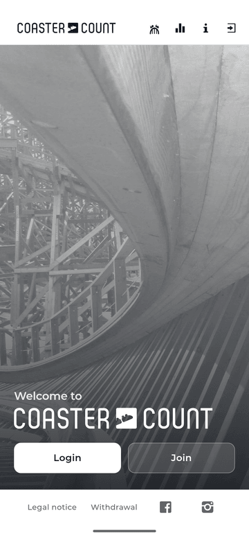
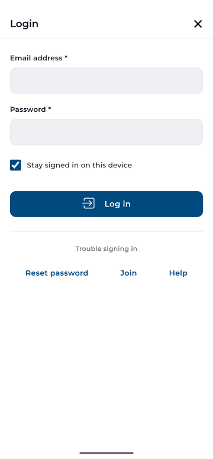
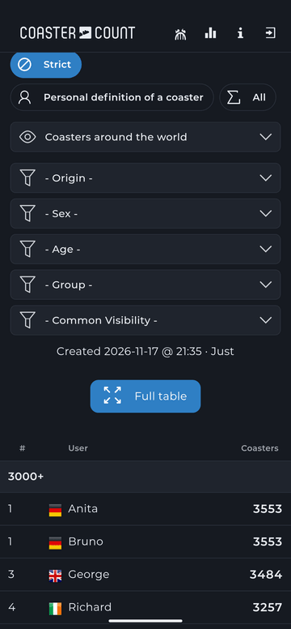
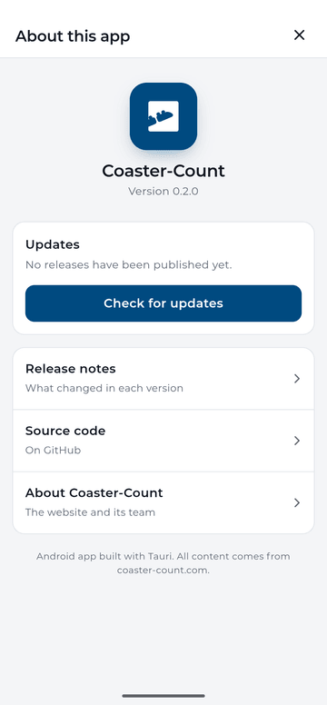

<div align="center">


# Coaster-Count for Android

> **Unofficial project:** this app is not affiliated with, endorsed by or maintained by Coaster-Count or its operators.

**[coaster-count.com](https://coaster-count.com) as a fast, clean Android app.**<br>
Count your rides, browse the catalogue and compare rankings, with a modern look that follows your phone's light or dark mode.

[](https://github.com/Sooeeren/CoasterCount-Android/releases/latest)


[**Download the APK**](https://github.com/Sooeeren/CoasterCount-Android/releases/latest/download/CoasterCount.apk)

<br>

&nbsp;
&nbsp;
&nbsp;


</div>

## Install

1. Open the [latest release](https://github.com/Sooeeren/CoasterCount-Android/releases/latest) on your phone and download **CoasterCount.apk**.
2. Open it. Android asks once to allow installs from your browser. Allow it, then tap **Install**.
3. Sign in with your Coaster-Count account as usual.

**Updates install from inside the app.** When a new version is out, a banner offers it on launch.
You can also check any time under **ⓘ / ⋯ → About this app**.

## What's different from the website

- **Feels like an app.** A one-row header, flat menus, a full-screen login, roomy touch targets and no sideways scrolling.
- **Light and dark.** Follows your system setting, including the parts of the site that hard-code dark icons.
- **The home screen fits one screen,** with Log in / Join right there when you're signed out.
- **Links to other sites** (RCDB, maps, PayPal, social) open in your browser; the app stays on Coaster-Count.
- **Android back button** walks back through pages; an offline screen appears when there's no connection.
- **In-app updates** from GitHub Releases, verified by Android against the app's signing key.

Everything you see is the live coaster-count.com: your account, counts and data stay on the site.

---

## How it works

```
App start ─► src/index.html            splash + connectivity check (bundled)
                │ location.replace
                ▼
        https://coaster-count.com  ◄── injection bundle runs at document start on every page
                │                      inject/core.js + styles/*.css + features/*.js
                │ link to another site
                ▼
        system browser
```

| Piece | Where | What it does |
|---|---|---|
| Window + navigation guard | `src-tauri/src/lib.rs`, `nav.rs` | Creates the webview, injects the bundle, keeps `*.coaster-count.com` in the app |
| Rust commands | `src-tauri/src/commands.rs` | `app_info`, `open_external`, `install_update`, callable from injected JS |
| Permissions | `src-tauri/capabilities/remote.json` | The **only** things the live site may call |
| Update installer | `src-tauri/plugins/apk-installer` | Kotlin plugin: downloads the APK, opens Android's installer |
| Injection bundle | `src-tauri/build.rs` | Bundles `inject/**` into one script at compile time |
| Runtime API | `inject/core.js` | `window.CCW`: styles, feature registry, IPC bridge, link handling |
| Splash / offline | `src/index.html` | Probes the network, then hands over to the site |

## Customising

### Styles

CSS in `inject/styles/` is bundled in alphabetical order and applied **after** the site's own
stylesheet. Scope rules under `html.ccw-app`. Prefix a file with `_` to disable it.

| File | Covers |
|---|---|
| `00-app-base.css` | Safe areas (edge-to-edge), page layout, no sideways scroll |
| `10-theme.css` | Design tokens (`--ccw-*`) for light and dark: change colours here |
| `20-chrome.css` | Header, dropdown menus, footer |
| `30-home.css` | Full-screen home, Log in / Join buttons |
| `40-forms.css` | Full-screen popups, inputs, buttons, selects |
| `50-content.css` | Headings, tables, stats, rankings, news; dark-mode repairs |
| `60-app.css` | App-owned UI: About sheet, update banner |

### Features

Drop a JS file into `inject/features/`. Each runs isolated in its own `try/catch`:

```js
CCW.feature('bigger-counters', function (CCW) {
  document.querySelectorAll('.count').forEach((el) => el.classList.add('ccw-big'));
}, { defaultEnabled: true });
```

API (see `inject/core.js`): `CCW.feature`, `CCW.css`, `CCW.onReady`, `CCW.onNavigate`, `CCW.invoke`,
`CCW.openExternal`, `CCW.isInternalUrl`, `CCW.settings`, `CCW.isFeatureEnabled`, `CCW.setFeatureEnabled`,
`CCW.updates.check` / `CCW.updates.install`.

### Native (Rust) features

1. Add a `#[tauri::command]` in `src-tauri/src/commands.rs` and register it in `lib.rs`.
2. Add its name to `APP_COMMANDS` in `src-tauri/build.rs`.
3. Grant `allow-<name>` (underscores become hyphens) in `capabilities/remote.json`.
4. Call it from JS: `CCW.invoke('my_command', { … })`.

Anything in `remote.json` is callable by **any** script on coaster-count.com, so validate arguments in Rust.

## Building

You need Node 20+, Rust (on Windows the MSVC toolchain), the Android SDK + NDK, and a JDK
(Android Studio's bundled one works). On Windows also turn on Developer Mode (for symlinks).

```powershell
$env:JAVA_HOME    = "C:\Program Files\Android\Android Studio\jbr"
$env:ANDROID_HOME = "$env:LOCALAPPDATA\Android\Sdk"
$env:NDK_HOME     = "$env:LOCALAPPDATA\Android\Sdk\ndk\<version>"

npm install
npm run android:build:debug -- --target aarch64   # debug APK, installable as-is
npm run android:dev                               # live on a device or emulator
```

Debug builds can be inspected from desktop Chrome at `chrome://inspect`.
Turn on logging there with `CCW.settings.set('debug', 1)`.

**App icon:** `assets/icon.png` is generated from the brand mark in `assets/brand-mark.svg`;
`npm run icons` rebuilds it and every launcher size.

## Releasing

Every release must be signed with **the same key**, or Android refuses to install it as an update.

1. Signing is configured in `src-tauri/gen/android/keystore.properties` (git-ignored):
   ```properties
   storeFile=C:/Users/<you>/.android-keys/coastercount-release.jks
   password=…
   keyAlias=coastercount
   ```
   **Back up the keystore and its password.** Without them, users must uninstall to update.
2. Publish a version:
   ```bash
   npm run release -- 0.3.0
   ```
   This bumps the version, builds a signed APK (arm64 + armv7), tags `v0.3.0`, pushes and creates a
   GitHub release with `CoasterCount.apk` attached. Installed apps offer the update on their next
   launch check (at most every 6 hours) or right away via **About this app → Check for updates**.
   Add `--dry-run` to build without publishing.

## Credits

All content, data and the Coaster-Count name and logo belong to [coaster-count.com](https://coaster-count.com).
This repository only contains the Android shell and its styling.

Built by [Sooeeren](https://github.com/Sooeeren) together with [Claude](https://claude.com/claude-code) (Anthropic).
